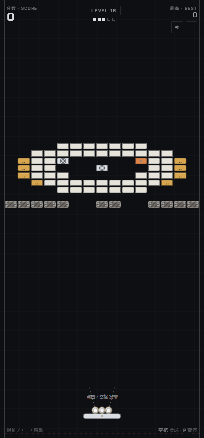

# 打砖块 · Brick Breaker

OpenChamber 侧栏里的打砖块小游戏：每次发球三颗，底部反弹板接住弹球，打碎上方所有砖块。打中白色回弹核心，弹力球会自己弹来弹去清掉大半场地。进度自动保存，下次打开可以接着打。简洁的平面色块画风，只有弹球带一点辉光。

<p align="center">
  
</p>

## 这种游戏叫什么

- 中文：**打砖块**
- 英文：**Breakout**（1976，Atari）
- 加入道具、关卡与不可破坏钢砖的街机版本：**Arkanoid**（1986，Taito）

## 安装

在 OpenChamber 的 **Settings → Extensions** 里添加：

```text
https://github.com/Insulindian/openchamber-brick-breaker
```

构建产物 `panel/main.js` 已提交，安装不需要构建工具。已安装的话，用扩展更新器更新。

## 操作

- 指针 / ← → / A D：移动反弹板
- 空格 / 点击画面：发球
- P / Esc / 右键：暂停
- R：重开本关
- M：静音

## 内容

- 22 种手写关卡阵型，其中最后两关各有上千块砖；通关后循环并提升砖块耐久与球速
- 普通关 15 列、9～10 行；最后两关是 27/30 列、40/42 行、单关上千块砖的大关
- 关卡结构：硬砖和钢墙放在底部，只留 2～3 个 2～3 格宽的缺口；钢墙离挡板更近，球穿过缺口后，上方大片易碎砖会很快被清掉
- 每次发球时三颗球都会显示一条方向虚线，方便瞄准底部缺口
- 主菜单或暂停界面可以直接选关，从任意一关重新开始
- 每关有 1～3 个白色回弹核心：打碎后放出 6 颗弹力球，在四壁间自动反弹 7 秒，通常能清掉大部分砖块；多个核心可以连锁
- 可破坏砖块：白砖 1 下、黄砖 2 下、红砖 3 下，裂纹随伤害加深
- 不可破坏钢砖：灰色斜纹砖，只能反弹，不计入通关条件
- 爆破砖：击碎时引燃周围八格，可连锁
- 每次发球有 3 颗球；分裂会让场上每颗球都拆成三颗，3→9→27→81，最多 81 颗
- 2 种道具：分裂 / 加命；分裂掉落频率大幅提高，宽桨已移除
- 连击倍率、碎片与火花粒子
- WebAudio 合成音效，右上角可静音
- 自动保存关卡、分数和生命，主菜单可以继续；最高分也写入扩展存储
- 失焦自动暂停；支持触屏拖动

## 开发

```sh
npm install
npm run build
```

调试参数：`?play=1` 直接开局、`?level=N` 起始关卡、`?auto=1` 自动接球、`?god=1` 不掉命、`?sim=N` 固定步长、`?steps=N` 预演步数、`?drop=all` 掉落全部道具、`?dbg=1` 显示帧率。

画面全部由 Canvas 程序化绘制。字体 Chakra Petch + ZCOOL QingKe HuangYou（SIL OFL，`panel/fonts/` 内附授权）。
